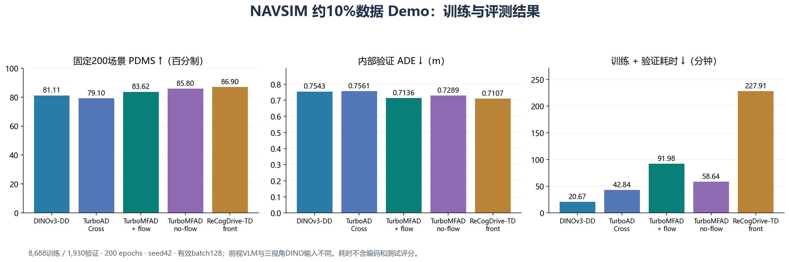
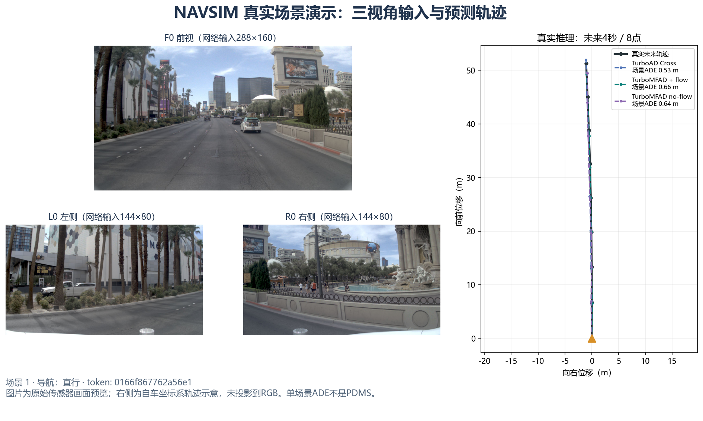
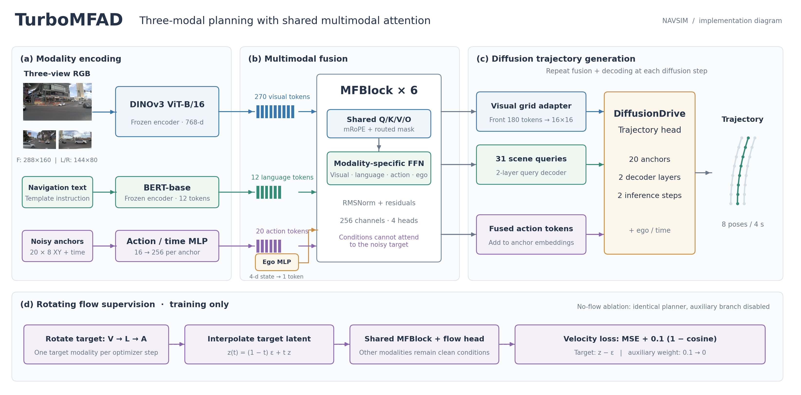

# AD / ReCogDrive 基础实验

## 最新实验：纯视觉 NAVSIM（2026-11-02）

五组训练与固定 200 场景评测已完成：DINOv3-DD 81.11、TurboAD Cross 79.10、TurboMFAD + flow 83.62、TurboMFAD no-flow 85.80、前视 ReCogDrive-TD 86.90 PDMS（百分制）。输入与结构存在差异，详见 [GitHub 部署与复现说明](bimodal_smoke/GITHUB_DEPLOYMENT.md) 和 [完整分项指标](output/charts/NAVSIM_detailed_metrics.md)。模型权重及实际运行源码已单独归档本地，不纳入普通 Git 提交。

模型结构、收敛曲线与评分分项见部署说明，高清 PNG / SVG 及原始数据位于 [`bimodal_smoke/assets/navsim/`](bimodal_smoke/assets/navsim/)。

真实测试场景演示（三视角输入 + 三版模型预测与真实轨迹）：

下方为早期实验记录，数据和模型协议与最新纯视觉实验不同。

基础版本：`v0.1-front-camera-demo`。

已验证官方 ReCogDrive 2B IL 在真实 NAVSIM 前视图上的三样本推理。运行方式、结果及限制见 [demo 说明](recogdrive_demo/README.md)。

新增 RGB + LiDAR 双模态实验：TurboVLA cross-attention 与 MF 融合均完成 50 step 训练及原始传感器推理，结构、复现入口和结果见 [双模态 smoke 说明](bimodal_smoke/README.md)。当前仅验证三样本链路，不作为性能评测。

cross-attention 版本后续统一命名 **TurboAD**，正式训练子集和 ReCogDrive PDM 评测适配见 [TurboAD 说明](bimodal_smoke/TURBOAD.md)。

上游：https://github.com/xiaomi-research/recogdrive ，固定提交 `5831ee83c7a6a40bf6919715b96b0e9ba2b48335`。本仓库归档实验入口及结果，上游代码保留在服务器独立目录。

当前实验版本：**v0.5-turbo-mfad-navsim-pilot**。Turbo-MFAD 已完成相同训练配置及 200 场景评测，PDMS 为 61.44（TurboAD 为 46.44）。这仍是小样本单种子试跑，详见 [版本索引](VERSIONS.md) 和 [MF 实验记录](bimodal_smoke/TURBO_MFAD.md)。

新增 [TurboAD-Plus 三视角试验](bimodal_smoke/TURBOAD_PLUS.md)：已完成相同协议训练和 200 场景评测，PDMS=43.88；本轮没有多视角收益，保留单视角 MF 效果基线。
