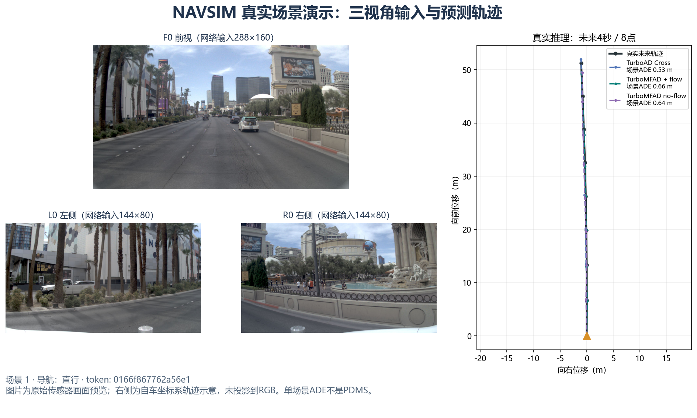
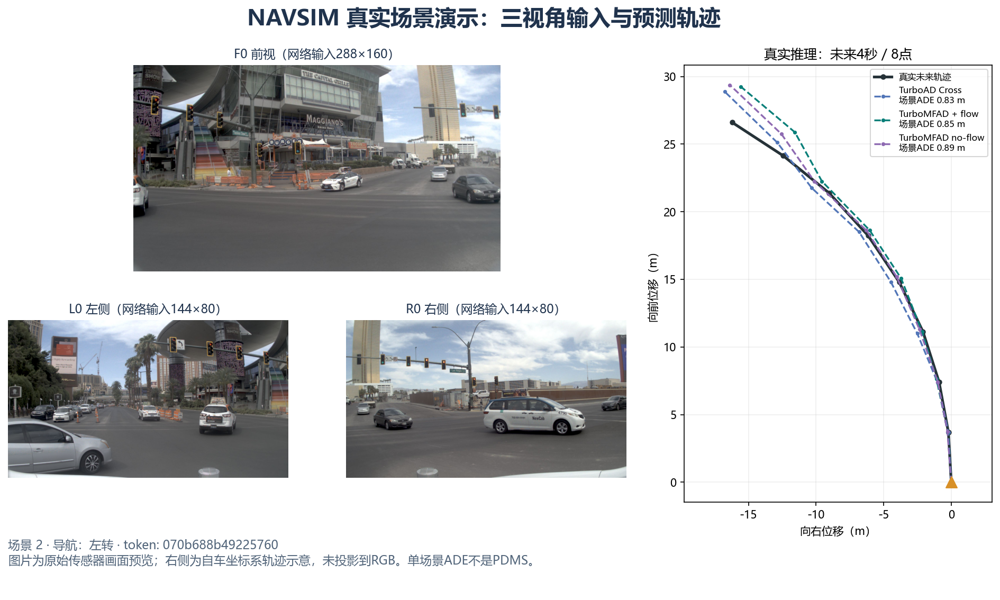
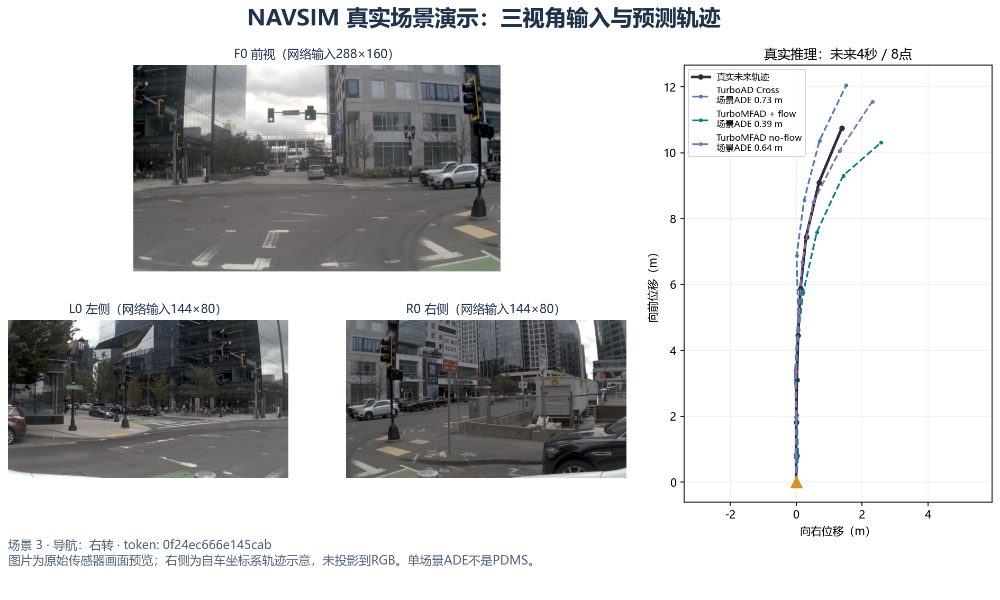
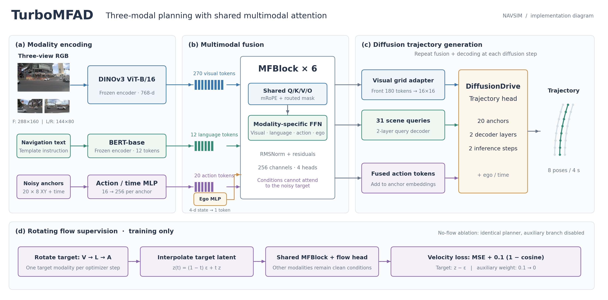
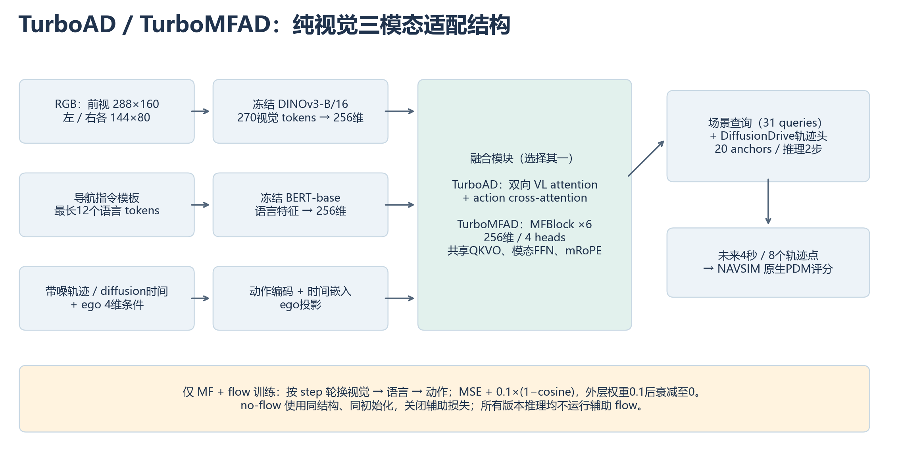
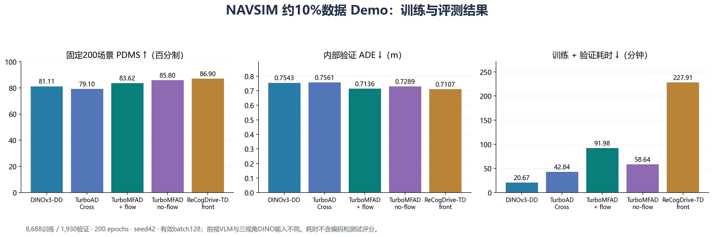
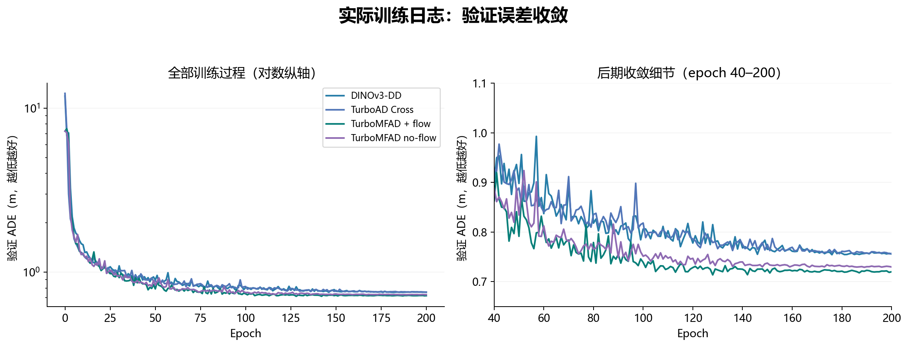
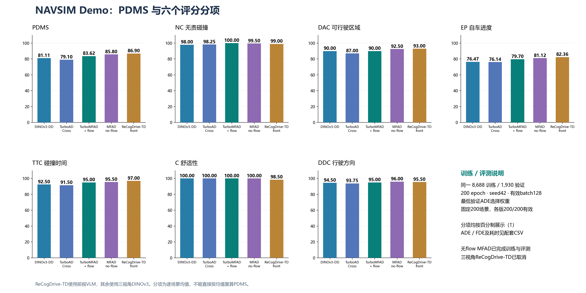

# NAVSIM 纯视觉 TurboAD / TurboMFAD：部署与复现

本说明对应 **2026-11-02 实验室 RTX 3090 实验**。与早期 RGB+LiDAR、AutoDL 数据划分分开记录。当前阶段目标为训练、轨迹生成和 NAVSIM 评测链路验证。

## 展示图

### 真实场景推理 Demo

从固定200场景清单中，按各导航指令首次出现的位置选取三例，不按分数筛选。每例含原始三视角预览，以及 Cross / MF+flow / MF no-flow 的实际预测和真实未来轨迹。右侧是自车坐标轨迹图，非相机投影或闭环驾驶视频。







轨迹数据：[scene_demo_predictions.json](assets/navsim/scene_demo_predictions.json)。相机预览展示原始比例，网络实际输入大小已标注。图例中的单场景 ADE 与汇总验证 ADE 不同，不代表 PDMS。

### MF 与辅助目标详细结构



提供 [SVG矢量版](assets/navsim/mfad_architecture_detailed.svg)。

### 模型结构



### 结果与训练成本



### 训练收敛



### PDMS 与各子项



图片均提供同名 SVG 矢量版；可下载 [指标原表](assets/navsim/metrics.csv) 与 [曲线原始数据](assets/navsim/training_curves.csv)。图由 `python bimodal_smoke/build_github_figures.py` 从实际日志生成；不需要重新运行模型。场景 Demo 与 MF 详细结构图分别由 `build_scene_demos.py` / `build_paper_architecture.py` 生成；原始相机预览不入库，重建前先运行 `fetch_demo_images.py` 从服务器取回。

## 1. 模型与已完成结果

| 方法 | 输入与融合 | PDMS ↑ | 验证 ADE / FDE（m）↓ | 训练+验证（分钟） |
|---|---|---:|---|---:|
| DINOv3-DD | 三视角冻结 DINOv3，导航与 ego 数值条件，无 BERT/MF | 81.11 | 0.7543 / 1.8833 | 20.7 |
| TurboAD Cross | 三视角 DINOv3 + BERT 指令；双向 VL cross-attention + action cross-attention | 79.10 | 0.7561 / 1.8951 | 42.8 |
| TurboMFAD + flow | 视觉/语言/动作 MF 融合，轮换辅助 flow | 83.62 | 0.7136 / 1.7423 | 92.0 |
| TurboMFAD no-flow | 相同 MF 结构和初始化，关闭辅助 flow | 85.80 | 0.7289 / 1.7863 | 58.6 |
| ReCogDrive-TD front | 冻结前视 ReCogDrive VLM，替换为 DiffusionDrive 轨迹头 | 86.90 | 0.7107 / 1.7467 | 227.9 |

PDMS 为百分制。每版测试均 200/200 有效。ADE/FDE 为内部验证集，非测试集误差。ReCogDrive-TD 的视觉输入、场景查询层数和 anchors 与其他四组不同，不能把差异全部归因于融合模块。原生 ReCogDrive 未完成同预算训练，不列最终成绩；三视角 ReCogDrive-TD 只做过探针，已取消完整训练。

完整分项：[`../output/charts/NAVSIM_detailed_metrics.csv`](../output/charts/NAVSIM_detailed_metrics.csv)，含 NC、DAC、EP、TTC、舒适性、DDC，以及权重 epoch 和耗时。

### TurboMFAD 结构

前视 RGB 288×160 + 左右各 144×80 → 冻结 DINOv3-B/16 → 180+45+45=270 个视觉 tokens；导航模板 → 冻结 BERT-base-uncased → 最长 12 个语言 tokens；ego 为 4 维条件；带噪轨迹作为动作 tokens。MFBlock ×6，宽度 256、4 heads、共享 QKVO、模态专属 FFN、空间 mRoPE。条件 tokens 不读取带噪目标。融合后场景查询与 DiffusionDrive 轨迹头输出未来 4 秒、8 个点，评测采样 2 步。

辅助版按 optimizer step 轮换 vision → language → action：`z_t=(1-t)*noise+t*clean`，速度目标 `clean-noise`；loss 为 `MSE + 0.1*(1-cosine)`，外层权重前 60% 更新为 0.1，之后线性降至 0。推理不执行辅助分支。no-flow 版训练入口对 `flow_loss` 加断言，禁止调用；`initialization_match.json` 记录与辅助版初始化逐张量一致。

## 2. 产物和代码位置

本地归档：`output/lab_archive_20261102/`。

适合纳入 Git 的实际运行源码副本位于 [`lab_visual_release/`](lab_visual_release/)，与归档 `multiview/` 一致。部署时将该目录内 Python 文件复制到目标 `visual_vla/multiview/`，将 `run.sh` 放到目标 `visual_vla/`；保留或按新机器修改绝对路径。此目录不包含上游源码片段、编码器、数据及权重。

```text
multiview/                 # 服务器实际运行源码（优先于早期 AutoDL 草稿）
src/                       # 实际使用的三个上游依赖源码片段
outputs/<variant>/
  best_val_ade.pt           # 最佳验证权重（含训练状态，非冻结编码器）
  initial.pt               # 初始化权重；ReCogDrive-TD 未提供该文件
  config.json, history.json
  evaluation_trained.json  # TD 对应 evaluation.json
  scores_trained.csv       # TD 对应 scores.csv，含逐场景分项
outputs/shared/            # manifest、test_manifest、protocol
outputs/logs/              # 训练/评测日志
RUN_LOG.md
requirements.lab-freeze.txt
SHA256SUMS.json             # 下载文件 SHA256 校验清单
```

未下载原始传感器、地图、metric cache、冻结编码器及多 GB 特征缓存；未复制冗余 latest 权重。因此这是结果/权重归档，离线独立推理仍须补齐依赖资源。`src` 是服务器源码片段，不含完整上游 Git 历史，无法核实其提交号；用文件 SHA256 固定当前实现，不伪造版本号。

## 3. 已验证的实验室环境

Linux + CUDA，单卡 RTX 3090 24GB；Python 环境 `/home/yiding/TurboVLA-repro/env/bin/python`，实际依赖清单见归档 `requirements.lab-freeze.txt`。现有 `sitecustomize.py` 还引用旧 ReCogDrive 环境补充 NAVSIM 依赖，不能仅安装 freeze 就宣称全新环境部署成功。

根目录：`/data/ruiqiwang/recogdrive_baseline`；模型工作目录：其下 `visual_vla`。依赖：ReCogDrive/NAVSIM scorer，DiffusionDrive 轨迹头，TurboVLA fusion，Multimodal-Flow 的 `mf` 包。上游公开入口：[ReCogDrive](https://github.com/xiaomi-research/recogdrive)、[DiffusionDrive](https://github.com/hustvl/DiffusionDrive)。TurboVLA/MF 使用当前实验对应源码快照，发布前应补全其来源和许可证。

```bash
cd /data/ruiqiwang/recogdrive_baseline/visual_vla
bash run.sh -c "import torch, transformers; from turbo_cross_vla import CrossPlanner; from visual_mf_vla import MFPlanner; print(torch.__version__, transformers.__version__)"
```

不要直接运行仓库中的 `deploy_*.py` 来复现：这些是历史 SSH 部署工具，会改写远程文件。复现应使用归档的实际运行源码。

## 4. 数据、编码器与缓存准备

- 数据池 10,618 场景，约为官方 navtrain 的 10%；其中训练 8,688，验证 1,930，按 log 隔离。固定独立 navtest 200 场景。
- 保留归档 manifest 的 token、split 和顺序，不重新抽样；原始清单 SHA256：`e0a72e1eb409f01f577c3ed7c14510a6a7eb1463f62d00ba5d6a53289ad73f81`。
- 根目录需要 `demo10/manifest.json`、`turboad/navtest_subset_tokens.json`、NAVSIM 原始 metadata 和三个相机传感器、`data/maps`、`turboad/evaluation/metric_cache`。固定测试 tokens 可从归档 `outputs/shared/test_manifest.json` 按顺序提取。
- 编码器放 `visual_vla/weights/dinov3-vitb16` 与 `visual_vla/weights/bert-base-uncased`，从合法来源取得 Hugging Face 格式完整权重和配置。
- `outputs/shared/features.pt`、`test_features.pt` 为冻结特征缓存；缺失时用实际源码准备，不能直接喂入不存在的缓存。

```bash
CUDA_VISIBLE_DEVICES=0 bash run.sh multiview/lab_visual_prepare.py
```

该脚本依赖原 `demo10/manifest.json`；只有转换后的共享 manifest 时，应先补齐原清单，不能让 trainer 自动重新抽样。确认 protocol 为 8688/1930/200，且每组输出目录的 `manifest.json`、`features.pt` 指向共享文件。20 个 anchors 由训练集 k-means 得到，已随各组归档。

## 5. 训练与自动评测

预算：seed42、200 epochs、micro batch=effective batch=128；AdamW lr1e-4、wd1e-4、betas(0.9,0.95)，warmup3 + cosine 至 1e-6，BF16、clip1。按最低验证 ADE 选权重。训练时间不含下载、编码、缓存加载和测试评分。

**实验室 GPU1 禁止使用。** 以下入口中的 GPU 分配已经写死：双模型 pipeline 使用 GPU0/GPU2；独立 no-flow/DINO pipeline 使用 GPU0。不要同时重复启动。

```bash
# 两版：GPU0 cross、GPU2 MF+flow；完成后分别自动 PDMS
nohup bash run.sh multiview/lab_visual_pipeline.py > outputs/lab_pipeline.log 2>&1 &

# 或：单独 no-flow，GPU0；须先准备同初始化参考 outputs/multiview_mf_vla/initial.pt
nohup bash run.sh multiview/pipeline_mfad_no_flow.py > outputs/mfad_no_flow/controller.log 2>&1 &

# 或：DINOv3-DD，GPU0
nohup bash run.sh multiview/pipeline_dino_diffusiondrive.py > outputs/dino_diffusiondrive/controller.log 2>&1 &
```

启动前确保输出目录存在。以上命令适用于现有布局；备份已有输出后另开实验目录并统一修改路径，避免覆盖已有成果。训练器可读取 latest 恢复，归档未包含 latest；仅提供 best 权重不等同于自动恢复。

只重新评测已有权重：

```bash
CUDA_VISIBLE_DEVICES=0 bash run.sh multiview/lab_visual_score.py cross
CUDA_VISIBLE_DEVICES=2 bash run.sh multiview/lab_visual_score.py mf
CUDA_VISIBLE_DEVICES=0 bash run.sh multiview/score_mfad_no_flow.py cross
CUDA_VISIBLE_DEVICES=0 bash run.sh multiview/score_dino_diffusiondrive.py cross
```

评测脚本会跳过已存在的对应 evaluation JSON。重算时先将旧 evaluation 与 scores 移到独立备份目录。原始 JSON/逐场景 CSV 的 score 和子项为 0–1；展示时乘 100，不能重复乘。确认 `successful_scenarios=200`、`failed_scenarios=0`、权重哈希正确。

## 6. 迁移到新服务器

本版本不是通用 CLI，包含绝对路径。复制实际源码、依赖片段、编码器与数据后，统一修改 `multiview/*.py`、`run.sh`、`sitecustomize.py`、manifest 中的路径。特别检查 ReCogDrive repo、DiffusionDrive agents 路径、MF PYTHONPATH、TurboVLA fusion、Python 环境和地图路径。

先 import 检查，再单样本 `--smoke`，然后 200 场景评测；通过后才开始新训练。新服务器尚未重新部署验证，不能将实验室成功视作任意环境零配置运行成功。ReCogDrive-TD 复现另见 [RECOGDRIVE_DD.md](RECOGDRIVE_DD.md)，该组需要 VLM 和其原始缓存，不使用上述纯视觉 prepare。

## 7. GitHub 文件管理

Git 只提交源码、说明和小体积指标；不要提交 `login.md`、密码、SSH 配置、数据、缓存、环境、模型权重。本地归档已在 `.gitignore` 中排除。若需要分享权重，另外使用授权的模型托管或 Release，并附 SHA256、编码器依赖和数据协议。上游源码片段发布前核对许可证；当前归档不自动推送 GitHub。

更新指标：`python bimodal_smoke/export_comparison_metrics.py`；重新拉取归档：`python bimodal_smoke/archive_lab_results.py`（读取本地忽略的 login.md）。
